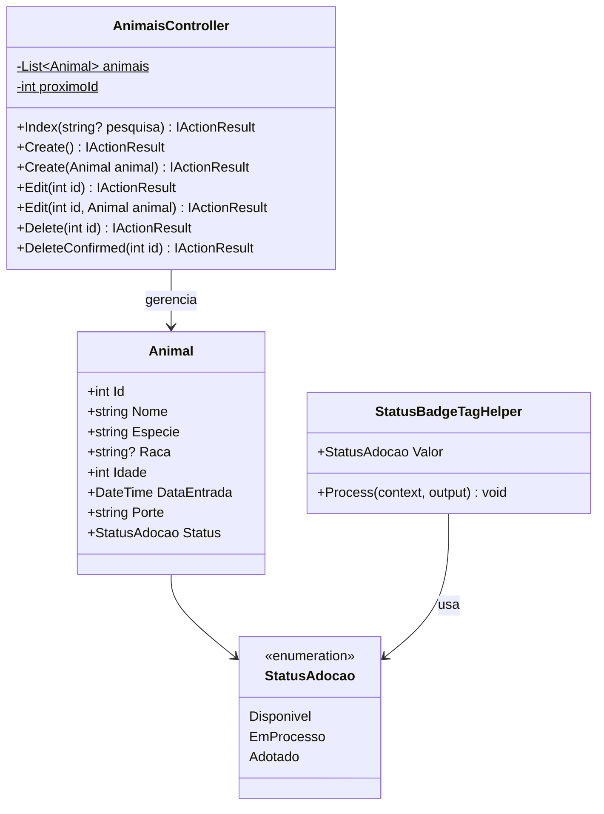
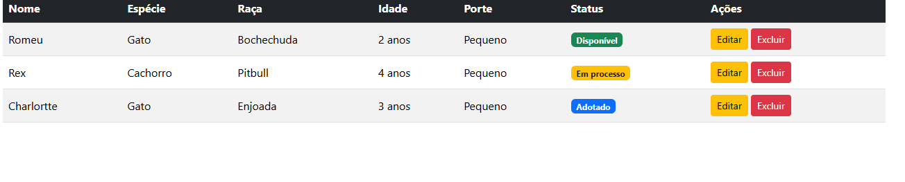
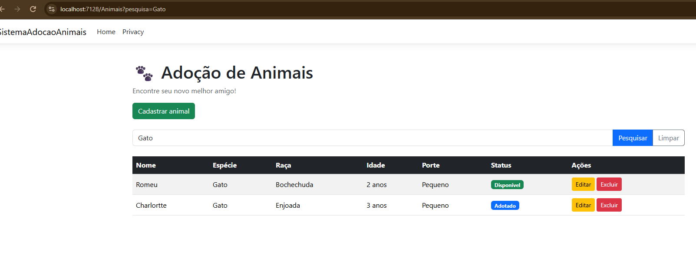
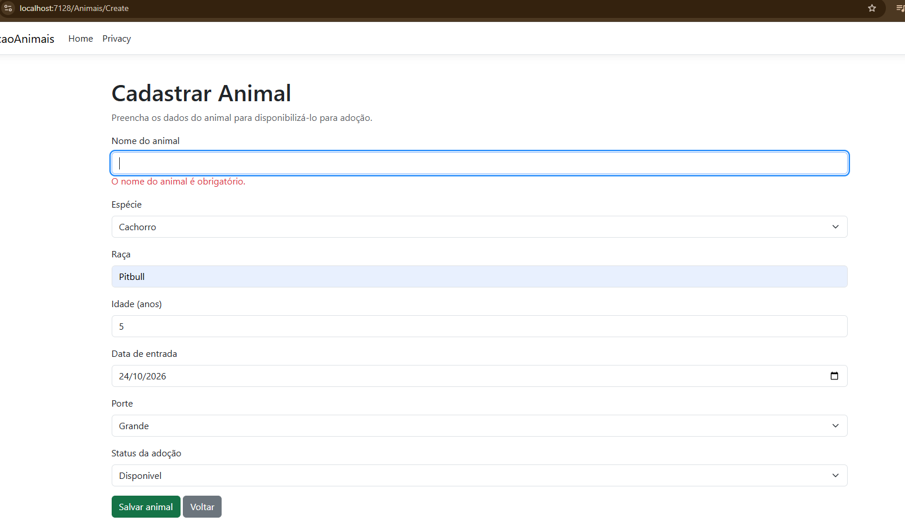
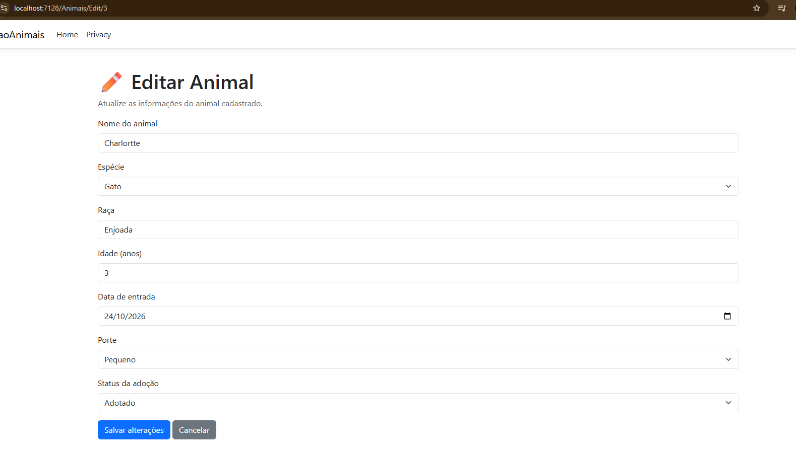
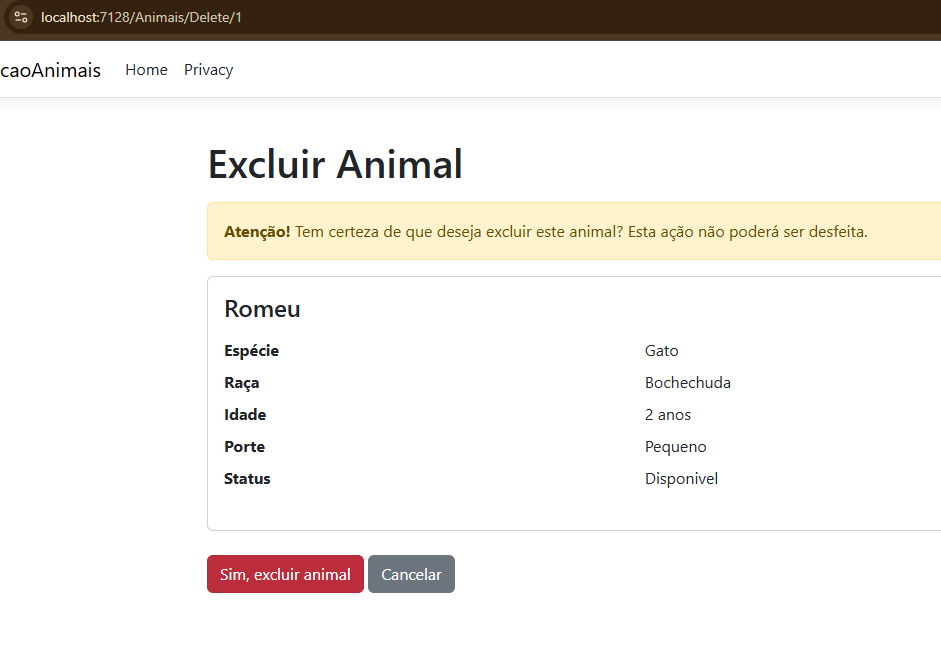
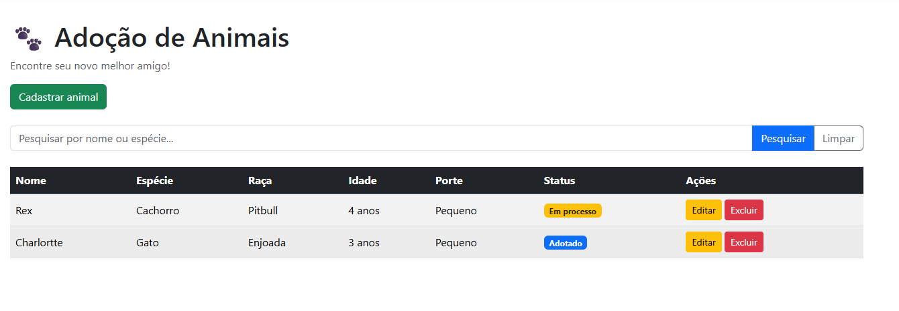

# 🐾 Sistema de Adoção de Animais

**FIAP – Análise e Desenvolvimento de Sistemas**
**Checkpoint 2 – ASP.NET Core MVC**
**Professor:**  Marcel Stefan Wagner

## Integrante

| Nome completo | RM |
|---|---|
| Manuella Rinaldi | 567915 |


---

## 1. Sobre o projeto

Aplicação web desenvolvida com **ASP.NET Core MVC** para gerenciar os animais disponíveis para adoção em um abrigo. O sistema permite cadastrar, listar, pesquisar, editar e excluir animais pelo navegador, acompanhando a situação de cada um (disponível, em processo de adoção ou adotado).

Conforme o enunciado, **não há banco de dados**: os dados ficam em memória, em uma lista estática no Controller. Ao reiniciar a aplicação, a lista volta vazia.

### Requisitos do enunciado atendidos

| Requisito | Onde foi atendido |
|---|---|
| CRUD completo no navegador | `AnimaisController` e Views `Index`, `Create`, `Edit`, `Delete` |
| Pesquisa por propriedade do modelo | Pesquisa por **nome** ou **espécie** na tela de listagem |
| Diferentes tipos de dados | `string`, `int`, `DateTime`, `enum` (`StatusAdocao`) |
| Tag helper criado e utilizado | `StatusBadgeTagHelper` (`<status-badge>`) |
| Confirmação de remoção | Tela de confirmação (`Delete`) antes de excluir |
| Layout da aplicação | Layout compartilhado com Bootstrap |
| Sem banco de dados | Lista estática em memória |

---

## 2. Tecnologias e pacotes

- **Linguagem:** C#
- **Framework:** ASP.NET Core MVC (.NET 10)
- **IDE:** Visual Studio 2026
- **Front-end:** Razor Views, HTML5, **Bootstrap** (incluído no template do projeto MVC)
- **Pacotes NuGet:** nenhum pacote adicional foi instalado; foram usadas apenas as bibliotecas do próprio framework `Microsoft.AspNetCore.App`.
- **Padrões e recursos utilizados:**
  - MVC (Model–View–Controller)
  - Tag Helpers (nativos `asp-action`, `asp-route-id`, `asp-validation-for` e um tag helper próprio)
  - Data Annotations para validação (`[Required]`, `[StringLength]`, `[Range]`)
  - Padrão Post/Redirect/Get nas operações de escrita
  - Proteção contra CSRF com `[ValidateAntiForgeryToken]`

---

## 3. Diagrama de classes



---

## 4. Estrutura do projeto

```
SistemaAdocaoAnimais/
├── Controllers/
│   └── AnimaisController.cs
├── Models/
│   └── Animal.cs              (classe Animal + enum StatusAdocao)
├── TagHelpers/
│   └── StatusBadgeTagHelper.cs
├── Views/
│   ├── Animais/
│   │   ├── Index.cshtml
│   │   ├── Create.cshtml
│   │   ├── Edit.cshtml
│   │   └── Delete.cshtml
│   ├── Shared/
│   │   └── _Layout.cshtml
│   └── _ViewImports.cshtml
├── docs/imagens/              
├── wwwroot/
└── Program.cs
```

---

## 5. Modelo de dados

| Propriedade | Tipo | Regra de validação |
|---|---|---|
| `Id` | `int` | Gerado automaticamente pelo Controller |
| `Nome` | `string` | Obrigatório, até 100 caracteres |
| `Especie` | `string` | Obrigatória |
| `Raca` | `string?` | Opcional (exibe "Não informada" quando vazia) |
| `Idade` | `int` | Entre 0 e 100 anos |
| `DataEntrada` | `DateTime` | Padrão: data atual |
| `Porte` | `string` | Obrigatório (usuário escolhe entre as opções) |
| `Status` | `StatusAdocao` (enum) | Padrão: `Disponivel` |

---

## 6. Endpoints

Rota padrão do MVC: `/{controller}/{action}/{id?}`.

| Método | Rota | Ação | Descrição |
|---|---|---|---|
| GET | `/Animais` | `Index` | Lista os animais |
| GET | `/Animais?pesquisa=gato` | `Index` | Lista filtrando por nome ou espécie |
| GET | `/Animais/Create` | `Create` | Exibe o formulário de cadastro |
| POST | `/Animais/Create` | `Create` | Valida e cadastra o animal |
| GET | `/Animais/Edit/{id}` | `Edit` | Exibe o formulário de edição |
| POST | `/Animais/Edit/{id}` | `Edit` | Valida e atualiza o animal |
| GET | `/Animais/Delete/{id}` | `Delete` | Exibe a tela de confirmação de exclusão |
| POST | `/Animais/Delete/{id}` | `DeleteConfirmed` | Exclui o animal |

**Respostas de erro:** `404 Not Found` quando o `id` não existe e `400 Bad Request` quando o `id` da rota difere do `id` do formulário na edição.

---

## 7. Telas

### 7.1 Listagem (`Index`)



Exibe todos os animais em uma tabela com nome, espécie, raça, idade, porte, status e as ações **Editar** e **Excluir**. Há um botão **Cadastrar animal** e a barra de pesquisa. Quando a lista está vazia, aparece o aviso *"Nenhum animal encontrado. Cadastre o primeiro!"*. A raça não informada é exibida como "Não informada". A coluna **Status** usa o tag helper `<status-badge>`, que mostra uma etiqueta colorida.

**Implementação:** a View recebe `List<Animal>` como modelo (`@model`) e percorre a lista com `@foreach`. Os botões usam os tag helpers `asp-action` e `asp-route-id`.

### 7.2 Pesquisa



O campo de texto envia um `GET` com o parâmetro `pesquisa`. O botão **Limpar** volta à listagem completa. O termo digitado permanece no campo, pois o Controller o devolve por `ViewBag.Pesquisa`.

**Implementação:** no `Index`, o Controller filtra a lista com LINQ (`Where` + `Contains`), comparando o termo com `Nome` e `Especie` **sem diferenciar maiúsculas de minúsculas** (`StringComparison.OrdinalIgnoreCase`).

### 7.3 Cadastro (`Create`)



Formulário para cadastrar um novo animal com nome, espécie, raça, idade, data de entrada, porte e status. Após salvar, o usuário é redirecionado para a listagem.

**Implementação:** a ação `Create` (GET) exibe o formulário. A ação `Create` (POST) verifica `ModelState.IsValid`, atribui o `Id` com o contador estático `proximoId`, adiciona o animal à lista e redireciona para `Index`.

### 7.4 Cadastro com validação


Ao tentar salvar com campos obrigatórios vazios ou valores inválidos, o formulário é exibido novamente com mensagens em vermelho abaixo de cada campo (por exemplo, *"O nome do animal é obrigatório."*).

**Implementação:** as regras ficam no Model, com Data Annotations. As mensagens são exibidas com `asp-validation-for`. Se `ModelState` é inválido, o Controller devolve a mesma View com o objeto preenchido.

### 7.5 Edição (`Edit`)



Formulário já preenchido com os dados do animal selecionado. As mesmas validações do cadastro são aplicadas.

**Implementação:** a ação `Edit` (GET) busca o animal pelo `id` e devolve `NotFound` se ele não existir. A ação `Edit` (POST) confere se o `id` da rota é igual ao do formulário, valida o modelo, localiza o registro existente e atualiza suas propriedades.


### 7.5 Exclusão ('Delete')


A opção de exluir um animal da lista.

### 7.7 Confirmação de exclusão (`Delete`)



Antes de remover, o sistema mostra os dados do animal e pede a confirmação. O animal só é excluído depois que o usuário confirma.

**Implementação:** o `Delete` (GET) apenas exibe a tela de confirmação. A exclusão acontece no `DeleteConfirmed` (POST), mapeado com `[ActionName("Delete")]`, e protegido por `[ValidateAntiForgeryToken]`.

---

## 8. Tag helper criado: `StatusBadgeTagHelper`

Arquivo: `TagHelpers/StatusBadgeTagHelper.cs`

Transforma o enum `StatusAdocao` em uma etiqueta (*badge*) colorida do Bootstrap.

| Valor do enum | Texto exibido | Cor |
|---|---|---|
| `Disponivel` | Disponível | Verde |
| `EmProcesso` | Em processo | Amarelo |
| `Adotado` | Adotado | Azul |

**Uso na View:**

```razor
<status-badge valor="@animal.Status"></status-badge>
```

**HTML gerado:**

```html
<span class="badge bg-success">Disponível</span>
```

**Registro** em `Views/_ViewImports.cshtml`:

```razor
@addTagHelper *, SistemaAdocaoAnimais
```

---

## 9. Testes realizados

Os testes foram feitos manualmente pelo navegador.

| Teste | Resultado esperado | Resultado |
|---|---|---|
| Cadastrar animal com dados válidos | Animal aparece na listagem | ✅ |
| Cadastrar com nome, espécie ou porte vazios | Mensagens de validação exibidas | ✅ |
| Cadastrar com idade fora de 0–100 | Mensagem de validação exibida | ✅ |
| Editar um animal | Dados atualizados na listagem | ✅ |
| Excluir (confirmando) | Animal removido | ✅ |
| Pesquisar por nome | Apenas animais correspondentes | ✅ |
| Pesquisar por espécie | Apenas animais correspondentes | ✅ |
| Pesquisar em maiúsculas/minúsculas | Mesmo resultado | ✅ |
| Limpar pesquisa | Lista completa novamente | ✅ |
| Acessar `Edit`/`Delete` com `id` inexistente | Erro 404 | ✅ |
| Badges de status | Cores corretas para cada status | ✅ |

---

## 10. Como executar

1. Clone o repositório:
   ```bash
   git clone https://github.com/manuellarinaldi/SistemaAdocaoAnimais.git
   ```
2. Abra o arquivo `.sln`/`.slnx` no **Visual Studio 2026**.
3. Pressione **F5** (ou **Ctrl + F5**) para executar.
4. O navegador abrirá a aplicação. Acesse `/Animais` caso não abra direto.

> Os dados são mantidos apenas em memória e são perdidos ao encerrar a aplicação.# 🐾 Sistema de Adoção de Animais

